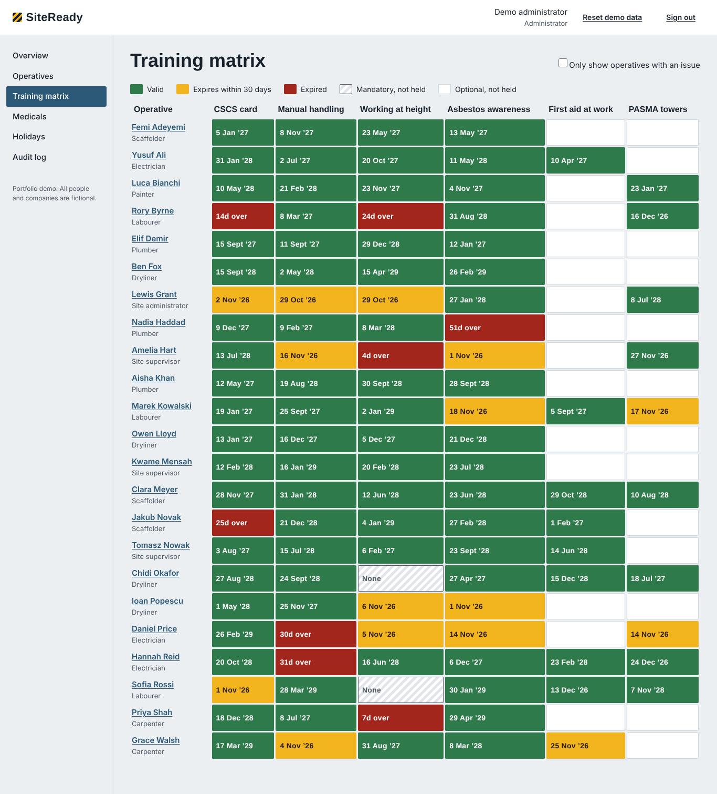
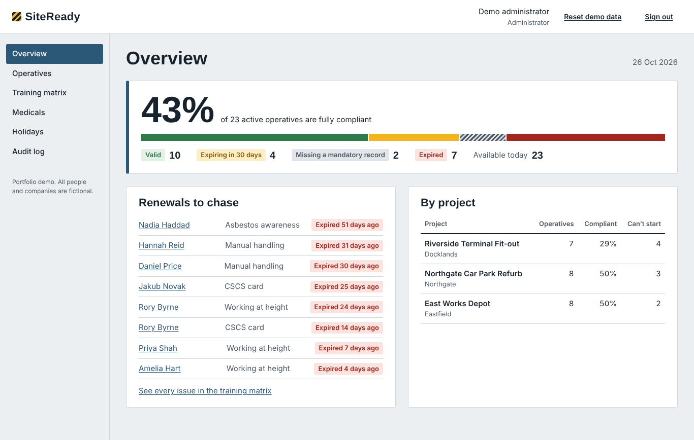
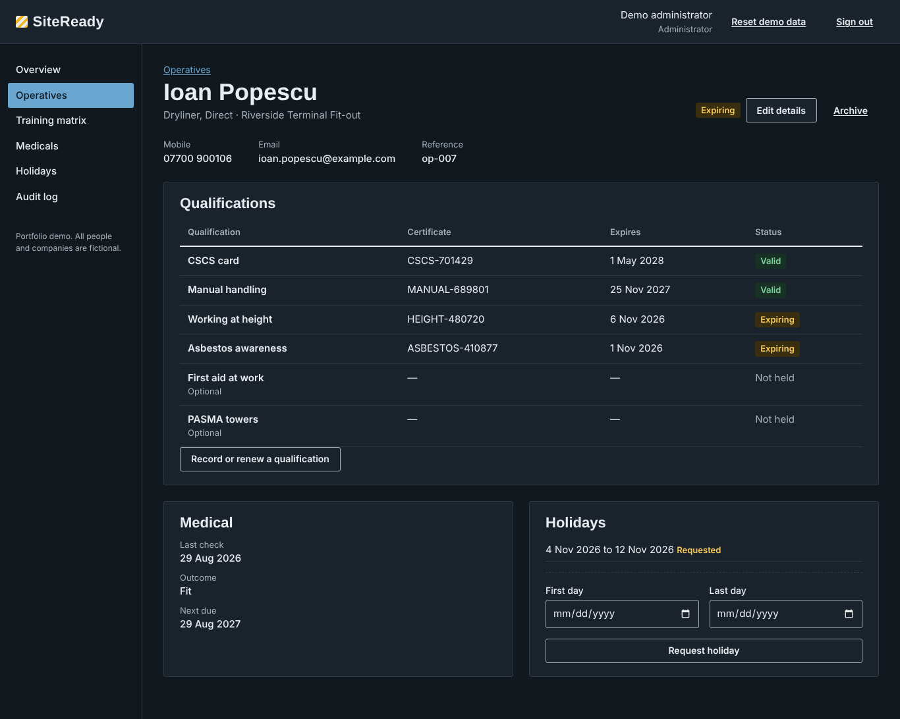
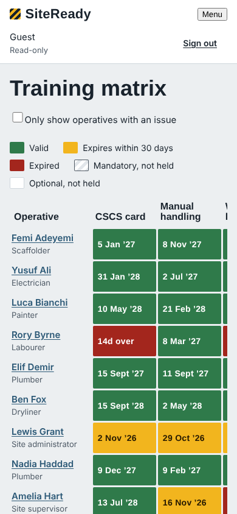

# SiteReady

**Workforce compliance tracking for construction sites.** SiteReady shows which operatives are cleared to work, which cards and training certificates are about to expire, and who is due a medical, so a site team can chase renewals before someone is turned away at the gate.

[**Open the live demo**](https://lastarus.github.io/sitecore-workforce-management/) — pick a demo account on the sign-in screen; no typing needed.



## Why I built it

I work in site administration on large construction projects, where I keep operative records, training certificates and medical checks up to date. That work used to live in spreadsheets that had to be checked by hand every week, and an expired card was usually spotted only when someone arrived on site.

SiteReady is the tool I wanted: one place for the records, and a view that makes problems obvious at a glance. Version 1 was a working prototype; this version 2 is a rebuild in React and TypeScript with a cleaner architecture and automated tests.

## What it does

- **Overview** — the share of the workforce that is fully compliant, renewals to chase, and which projects have people who can't start.
- **Training matrix** — every operative against every qualification, coloured valid, expiring within 30 days, expired or missing. Filter to only the people with an issue.
- **Operative records** — search and filter by name, trade, agency, project and compliance status; add and edit operatives with inline validation.
- **Qualifications** — record or renew a certificate; the expiry date is suggested from the course's normal validity.
- **Medicals and holidays** — overdue medicals sorted to the top; holiday requests that an administrator approves or declines.
- **Roles** — administrator (full access), site manager (only their two projects), guest (read-only, no contact details).
- **Audit log** — every change is recorded with who made it and when.

| Overview | Operative record (dark mode) | Mobile |
| --- | --- | --- |
|  |  |  |

## Tech stack

- **React 19** with hooks, context and a reducer for state
- **TypeScript** in strict mode
- **Vite** for development and builds
- **React Router** (hash routing, so deep links work on GitHub Pages)
- **Vitest** and **React Testing Library** — 25 tests
- **oxlint** for linting
- **GitHub Actions** — every push is linted, type-checked, tested and built; `main` deploys to GitHub Pages

## How it's put together

```
src/
  domain/        Pure business logic: types, date maths, compliance rules, validation
  data/          Storage boundary (WorkforceRepository) and fictional seed data
  state/         Reducer and React context; every change writes an audit entry
  auth/          Demo accounts and role permissions
  components/    Shared UI: layout, form fields, status badges
  pages/         One component per screen
```

A few decisions worth explaining:

- **Business rules are plain functions, not components.** `compliance.ts` decides what "expiring" or "missing" means, so the rules are tested directly and every screen agrees.
- **The UI never talks to storage directly.** Components go through a `WorkforceRepository` interface. The demo stores data in the browser; swapping in a real API or database means writing one new class, not touching any screens.
- **Demo data is generated relative to today**, from a fixed random seed, so the demo always shows a realistic mix of valid, expiring and expired records.
- **Accessibility is part of the build**: labelled form fields with announced errors, a skip link, visible keyboard focus, status shown in text as well as colour, and light and dark themes.

## Run it locally

```bash
npm install
npm run dev        # start the app at http://localhost:5173
npm test           # run the test suite
npm run build      # production build into dist/
```

Requires Node 22 or later.

## What I'd add next

- A real backend (Supabase or a small Node API) with proper authentication, replacing browser storage
- Email reminders 30 days before a qualification expires
- CSV import from existing spreadsheets, and PDF export of the training matrix

## Data and privacy

Every person, agency, project and certificate in this demo is fictional. Changes you make are saved only in your own browser; use **Reset demo data** (administrator) to start again. The demo passwords are public and protect nothing.

## Author

Built by **Catalin Lazar** — [GitHub](https://github.com/LaStarUs) · [LinkedIn](https://www.linkedin.com/in/catalinlazar25/)

## License

[MIT](LICENSE)
