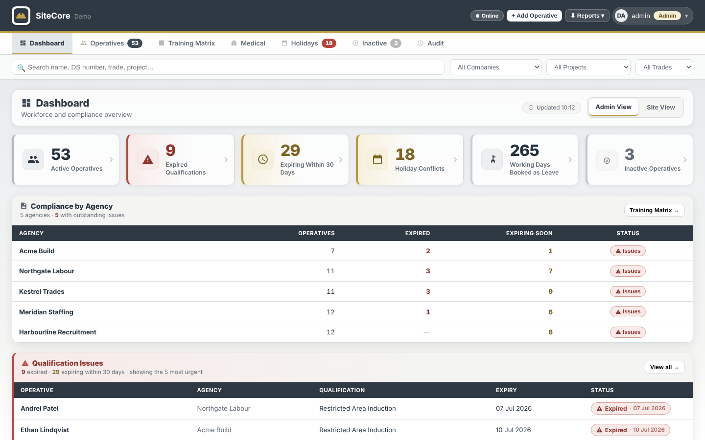

# SiteCore Workforce Management

A responsive workforce-management application developed to organise operative records, training compliance, qualifications, holidays, medical appointments and workforce reporting.

SiteCore was created by **Catalin Lazar** based on administrative and compliance workflows encountered during his employment at **C&W Contracts**.

This public portfolio version uses fictional demonstration data and does not provide access to C&W Contracts’ operational records.

## Live Demo

[Open SiteCore Workforce Management](https://lastarus.github.io/sitecore-workforce-management/)

## Key Features

- Centralised operative directory
- Detailed operative profiles
- Search, filtering and workforce segmentation
- Agency, trade, role and project allocation
- Training and qualification tracking
- Expiry-date monitoring and compliance alerts
- Medical appointment management
- Holiday request and absence tracking
- Site and project assignment
- Document and record management
- Workforce statistics and reporting
- Role-based permissions
- Administrator and guest access
- Activity and audit tracking
- Local browser storage
- Responsive desktop and mobile interface
- Fictional demonstration workforce records

## Demo Login

### Administrator

- Username: `admin`
- Password: `demo1234`

### Guest

- Username: `guest`
- Password: `demo1234`

These credentials are provided exclusively for the public portfolio demonstration and do not provide access to any real company system.

## Technologies Used

- HTML5
- CSS3
- JavaScript
- LocalStorage
- JSON
- Responsive web design
- Client-side form validation
- Dynamic data filtering and rendering
- Role-based interface controls

## Data and Privacy

The application runs locally in the browser. Records and settings are stored on the user’s device using browser storage.

The public demonstration contains fictional:

- Operative names
- Email addresses
- Telephone numbers
- Home addresses
- National Insurance numbers
- Agencies and employers
- Projects and work locations
- Training and medical records
- Qualification and holiday information

No genuine operative records, authentication credentials or confidential company documents are included.

Clearing the browser’s site data may remove locally stored changes and restore the application to its original demonstration state.

## My Contribution

I designed and developed the application, including:

- Workforce-management structure and navigation
- Operative profiles and record-management workflows
- Search, filtering and reporting functionality
- Training and qualification compliance monitoring
- Expiry warnings and status indicators
- Holiday-management workflows
- Medical appointment tracking
- Project and site allocation
- Role-based access and permissions
- Audit-history functionality
- Responsive user interface
- Local data storage and persistence
- Demonstration-data architecture
- Input validation and usability improvements
- Public-data sanitisation

## Portfolio and Company Disclaimer

SiteCore is presented as an independently developed software portfolio project based on professional administrative experience.

The public version is not an official C&W Contracts system and does not imply that C&W Contracts has approved, commissioned, endorsed or adopted this demonstration.

**C&W Contracts retains ownership of its company name and branding.** All operational data shown in this repository is fictional and included solely to demonstrate the developer’s technical abilities.

The software should undergo appropriate security, data-protection and operational review before being used with genuine employee or business information.

## Developer

Developed by **Catalin Lazar**

- GitHub: [LaStarUs](https://github.com/LaStarUs)
